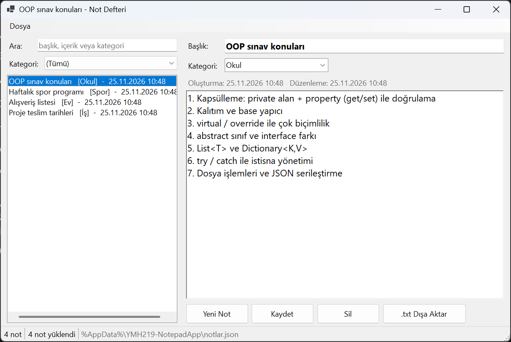
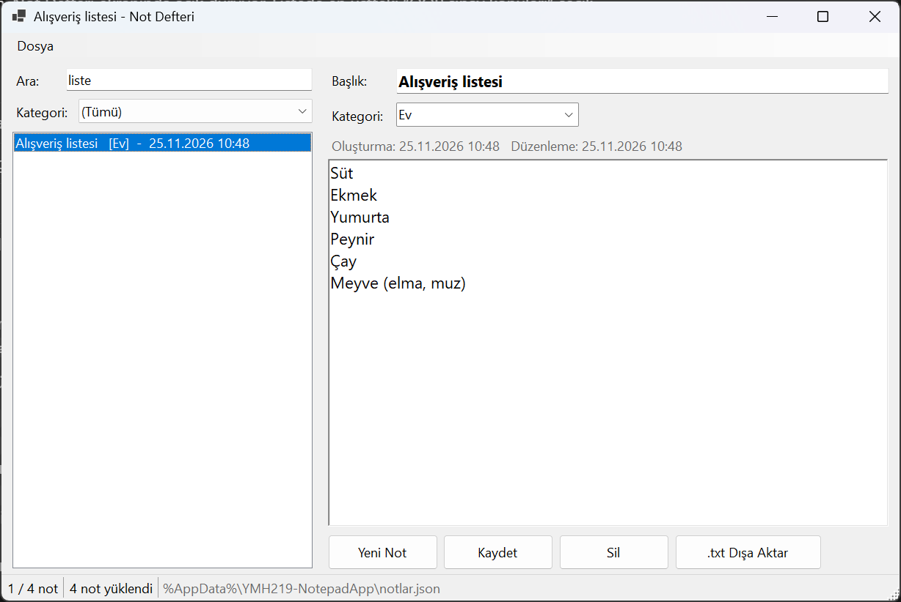

# YMH219-NotepadApp

Notları bilgisayarda kalıcı olarak saklayan Windows Forms not defteri uygulaması. Notlar JSON biçiminde bir dosyaya serileştirilir; uygulama kapatılıp açıldığında otomatik olarak geri yüklenir. Bir not düz metin (`.txt`) olarak dışa aktarılabilir.

Nesne Tabanlı Programlama (YMH 219) dersi ek uygulama ödevidir.

## Kullanılan Teknolojiler

- C# / .NET 10, Windows Forms (MenuStrip, ListBox, RichTextBox, StatusStrip)
- Dosya işlemleri: `System.IO` (`File`, `StreamReader`, `StreamWriter`)
- Serileştirme: `System.Text.Json`
- Harici NuGet paketi yoktur

## Sınıf Yapısı

| Sınıf | Görevi |
|---|---|
| `Not` | Başlık, içerik, kategori, oluşturma ve düzenleme tarihi; başlık doğrulaması property içinde |
| `INotDeposu` | Notların kaydedilip yüklendiği depolama arayüzü |
| `JsonNotDeposu` | Notları `List<Not>` olarak JSON dosyasına serileştirir; dosya yoksa boş liste, bozuksa yedek alıp `BozukDosyaException` fırlatır |
| `BozukDosyaException` | Not dosyasının geçersiz olduğunu bildiren özel istisna |
| `NotYoneticisi` | Ekle / güncelle / sil / ara işlemleri ve her işlemden sonra otomatik kayıt |
| `TxtDisaAktarici` | Bir notu `StreamWriter` ile `.txt` dosyasına yazar |
| `AnaForm` | Arayüz, kaydedilmemiş değişiklik kontrolü ve kullanıcı mesajları |

## Kurulum ve Çalıştırma

Gereksinimler: Windows, .NET 10 SDK (Visual Studio 2026 ".NET masaüstü geliştirme" iş yüküyle gelir).

**Visual Studio ile:** `NotepadApp.slnx` dosyasını açın ve `Ctrl+F5` ile çalıştırın.

**Komut satırıyla:**

```bash
dotnet run --project NotepadApp
```

Notlar şu dosyada saklanır: `%AppData%\YMH219-NotepadApp\notlar.json` (menüde **Dosya → Not Dosyasının Konumunu Aç**).

## Özellikler

- Başlık ve içerikten oluşan not **ekleme, listeleme, düzenleme ve silme** (silmeden önce onay)
- Notların JSON dosyasına **otomatik kaydedilmesi** (her ekleme, güncelleme ve silmeden sonra) ve açılışta **otomatik yüklenmesi**
- Her notun **oluşturma ve son düzenleme tarihi**; liste en son düzenlenen not üstte olacak şekilde sıralanır
- Seçili notu **.txt olarak dışa aktarma** (başlık, kategori, tarihler ve içerik)
- Başlık, içerik ve kategoride **arama**; **kategori** desteği ve kategoriye göre filtreleme
- Kaydedilmemiş değişiklik varken başka nota geçerken veya kapatırken uyarı
- Hata yönetimi: not dosyası yoksa boş listeyle başlar; dosya bozuksa yedeği alınır ve kullanıcı uyarılır; yazma hatalarında uygulama kapanmaz
- Kısayollar: `Ctrl+N` yeni not, `Ctrl+S` kaydet, `Ctrl+E` dışa aktar

## Ekran Görüntüleri

Not listesi ve düzenleme alanı:



Arama / kategori filtresi:



## Bilinen Sınırlamalar

- İçerik düz metin olarak saklanır; RichTextBox'taki yazı tipi biçimlendirmesi kaydedilmez.
- Tüm notlar tek bir JSON dosyasında tutulur; çok sayıda ve çok büyük notta her kayıtta dosyanın tamamı yeniden yazılır.
- Aynı anda birden fazla uygulama penceresi açılırsa son kaydeden diğerinin değişikliklerinin üzerine yazar.

## Geliştirici

Ebubekir Yılmaz – 250541051
